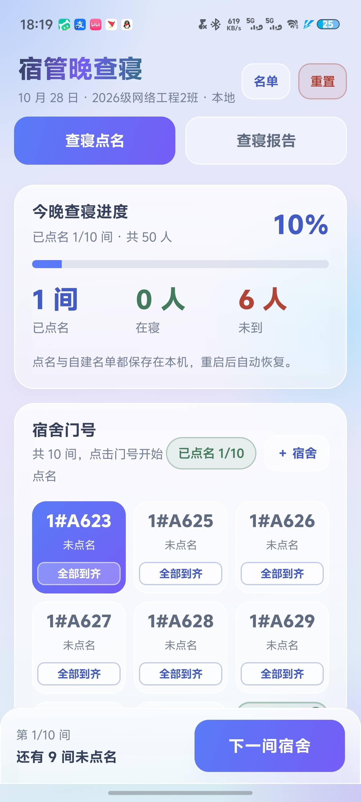
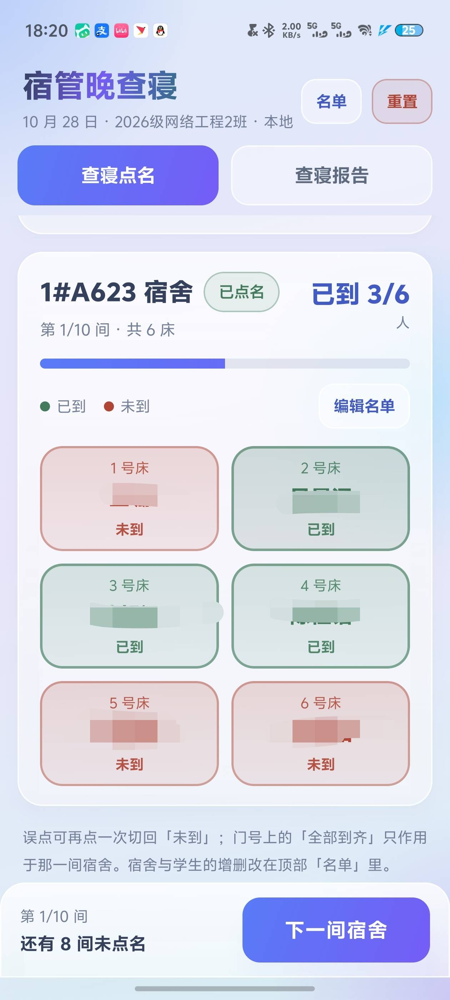
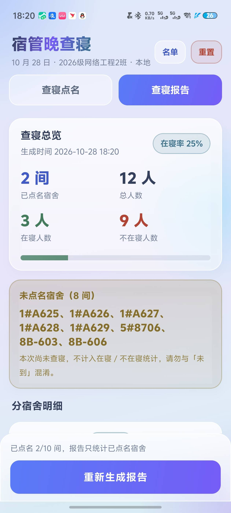

# 宿管晚查寝（DormRollCall）

Kotlin + Jetpack Compose + Material 3 的查寝点名工具，单 Activity + ViewModel 架构，视觉风格套用「液态玻璃 Lite」。
数据全部本地化：内置名单来自 assets，用户改动写入 DataStore，无需后端。

## 界面预览

| 查寝点名 | 宿舍点名 | 查寝报告 |
| :---: | :---: | :---: |
|  |  |  |
| 门号网格 + 全部到齐 | 红绿学生卡 | 一键生成报告 |

## 下载安装

直接下 APK 装上就能用：**[Dorm_Check-v1.0-public.apk](https://github.com/LYJ2025/Dorm_Check/releases/latest)**

- 要求 Android 7.0（API 24）及以上，无需联网、无需登录、无需任何权限
- **公开版不含任何宿舍或学生数据**：首次启动是空名单，点「＋ 宿舍」自己建，或从顶部「名单」导入
- 数据只保存在本机 DataStore，卸载或清除应用数据会丢失
- APK 签名指纹与 SHA-256 校验值见 [Releases](https://github.com/LYJ2025/Dorm_Check/releases) 说明

## 一、项目结构

```
DormRollCall/
├── settings.gradle.kts / build.gradle.kts / gradle.properties
├── local.properties                     # 只在本机存在（sdk.dir + 可选的名单路径），已 gitignore
├── .gitignore                           # 排除 roster.json / local.properties / build 产物
├── README.md
└── app/
    ├── build.gradle.kts                 # compileSdk 36 / minSdk 24 / Compose 1.9.4
    ├── proguard-rules.pro
    └── src/main/
        ├── AndroidManifest.xml
        ├── assets/
        │   ├── roster.json              # ★ 真实内置名单（含姓名），已被 gitignore
        │   └── roster.example.json      # 公开仓库里的假数据模板
        ├── res/                         # strings / colors / themes(±night) / 矢量图标
        └── java/com/example/dormcheck/
            ├── MainActivity.kt          # 单 Activity，edge-to-edge
            ├── data/
            │   ├── Models.kt            # Student / DormRoom / ReportRoom / CheckReport
            │   ├── RosterConfig.kt      # 解析 assets/roster.json（内置名单装载器）
            │   ├── LocalStore.kt        # DataStore：名单副本 + 点名结果
            │   └── MockDormData.kt      # 仅用于 @Preview 的假数据
            └── ui/
                ├── DormViewModel.kt     # 唯一状态源：名单 + 点名 + 报告
                ├── RosterActions.kt     # 名单增删改的能力集合（UI 与 VM 解耦）
                ├── AppRoot.kt           # 背景/顶栏/Tab/弹窗编排
                ├── screens/
                │   ├── CheckInScreen.kt # Tab1 查寝点名
                │   ├── ReportScreen.kt  # Tab2 查寝报告
                │   └── RosterDialogs.kt # 宿舍/学生的增删改弹窗
                ├── components/          # Glass 组件库、红绿学生卡、输入框
                └── theme/               # 颜色令牌、字体、Material3 主题
```

## 二、构建与运行

```bash
# 用 Android Studio 直接打开 DormRollCall 目录即可（推荐 JDK 17/21）
cd DormRollCall
./gradlew assembleDebug
# 产物：app/build/outputs/apk/debug/app-debug.apk
adb install -r app/build/outputs/apk/debug/app-debug.apk
```

已在本机验证：AGP 8.13.2 + Gradle 8.14.3 + Kotlin 2.2.21 + JDK 21，`assembleDebug` 通过，APK 约 12 MB。

### Release 正式版

```bash
./gradlew assembleRelease    # APK，可直接装手机
./gradlew bundleRelease      # AAB，上架应用商店用
# 产物：app/build/outputs/apk/release/app-release.apk    约 1.2 MB
#       app/build/outputs/bundle/release/app-release.aab  约 3.0 MB
adb install -r app/build/outputs/apk/release/app-release.apk
```

与 debug 版的差异：

| 项 | debug | release |
| --- | --- | --- |
| applicationId | `com.example.dormcheck.debug` | `com.example.dormcheck` |
| R8 代码压缩 / 资源裁剪 | 关 | 开 |
| APK 体积 | ~12 MB | ~1.2 MB |
| 签名 | 系统 debug 密钥 | 项目自有密钥（v2 方案） |

两个包 applicationId 不同，**可同时装在一台手机上**，但本地数据各自独立（debug 里录的点名不会带到 release）。

签名配置从 `local.properties` 读取（该文件已 gitignore，不进仓库）：

```properties
release.storeFile=keystore/dormcheck-release.jks
release.storePassword=********
release.keyAlias=dormcheck
release.keyPassword=********
```

- 密钥库：`keystore/dormcheck-release.jks`（RSA 2048，有效期 10000 天，`keystore/` 已整体 gitignore）
- 证书 SHA-256：`33:25:89:E1:31:CA:DA:4D:31:D7:2D:08:EF:FA:1E:8B:7E:04:42:21:0D:EE:D4:73:D9:1C:4F:B1:11:91:C3:82`
- 没配签名时 `release` 会自动回退 debug 签名，仍能产出可安装包（只有 `release` 走正式密钥时才需要口令）
- **密钥库和口令一旦丢失，后续版本无法覆盖安装升级**，务必单独备份 `keystore/` 目录

## 三、功能

**Tab1 查寝点名**

- 宿舍门号网格（LazyVerticalGrid，3 列）：未点名=中性玻璃、已点名=绿色玻璃 + 对勾、当前=渐变实心
- **每个门号卡片内自带「全部到齐」小按钮**：只把这一间宿舍整间标记为已到，其他宿舍完全不受影响；
  整间都到了按钮变灰显示「已全到」防重复点击，点错仍可进宿舍逐个点回「未到」
- 学生卡片 2 列，绿色=已到、红色=未到，**再点一次可纠正**；卡片上同时有「已到/未到」文字，不只靠颜色
- 顶部总览：已点名间数 / 在寝人数 / 未到人数 + 进度条；全部点完给出完成提示
- 当前宿舍：门号、第几间、已到 x/y、进度条、图例
- 底部固定「下一间宿舍」：当前宿舍没点完只弹轻提示，不阻止跳转
- 每人状态与「已点名」标记即时保存，切 Tab、转屏、杀进程重开都在

**Tab2 查寝报告**

- 「一键生成报告」生成快照：总览（已点名间数 / 总人数 / 在寝 / 不在寝 / 在寝率）
- 未点名宿舍单独一张黄色提示卡，明确「不计入统计、别和未到混淆」
- 按宿舍分组：门号 + 在寝 x/y + 缺几人 + 每个学生的红绿方块
- 附「不在寝名单」，可直接上报

**名单管理（内置与自建都开放）**

- 顶栏「名单」→ 名单管理：内置/自建间数统计、「重新导入内置名单」（只补缺失项，不覆盖修改）
- 门号区「＋ 宿舍」→ 新增宿舍
- 当前宿舍「编辑名单」→ 改门号、添加学生、改姓名/床号、删学生、删整间；删除均两步确认（第一次点变红，3 秒复位）

## 四、数据怎么分层（核心设计）

| 层 | 位置 | 是否可改 |
|---|---|---|
| 内置种子 | `assets/roster.json`（只读） | 不修改文件，只在首次启动时**复制**一份到本地 |
| 名单副本 | DataStore `roster_json` | 可增、可删、可改名/改床号 |
| 点名结果 | DataStore `present_student_keys` / `checked_room_ids` | 可切换、可重置 |

- 首次启动（`seeded=false`）把内置名单导入本地副本，并写入 `seeded=true`；
  之后所有读写都只针对本地副本，所以**改内置数据和改自建数据走完全相同的路径**，不存在被覆盖的问题。
- 用户把宿舍删到一间不剩，下次启动也不会被"重新种回来"（`seeded` 已置位）；
  想找回请用「名单管理 → 重新导入内置名单」，按门号/姓名只补缺失项。
- 内置项与自建项用 `isUserAdded` 标记，仅用于显示「自建」标签，不限制编辑权限。
- UI 状态由 `名单 + 点名数据` 派生（`rebuild()`），只有一份真相，不会出现两份状态互相打架。

## 五、敏感数据隔离与推送前清理

内置名单放在 `app/src/main/assets/roster.json`，**不进代码、不进版本库**：

1. `.gitignore` 已排除 `app/src/main/assets/roster.json`、`local.properties`、`build/`、`*.jks`；
   仓库里只保留 `roster.example.json`（假姓名模板）。
2. 想把名单放在仓库之外也能构建：在 `local.properties` 写
   ```properties
   dorm.roster.path=/Users/you/private/roster.json
   ```
   `app/build.gradle.kts` 里注册的 `syncRosterAsset` 会在 `preBuild` 前把它复制成 `assets/roster.json`。
3. 推送前自查（建议每次 `git push` 前跑一遍）：

```bash
git status --short                       # 确认 roster.json 不出现在待提交列表
git check-ignore -v app/src/main/assets/roster.json   # 应输出命中 .gitignore
git log --all --full-history -- app/src/main/assets/roster.json   # 应无历史记录
git grep -nE "张三|李四|王五" $(git rev-list --all) -- . | head   # 确认历史里没有真实姓名
```

4. 如果名单**曾经**被提交过：光加 `.gitignore` 不够，历史里还能翻出来。
   需要 `git filter-repo --path app/src/main/assets/roster.json --invert-paths`
   （或 BFG）重写历史并强推，同时让协作者重新 clone；必要时轮换仓库权限。
5. 打包发布时如果不想带任何内置名单：删掉 `assets/roster.json` 再构建，App 会以"空名单"启动，
   用户自行添加宿舍和学生。
6. 说明：APK 内的 `assets/roster.json` 可被解包读取，内置名单只适合内部使用，不适合公开发布的应用市场包。
7. 本次交付的 `app-release.apk` **已含真实名单**，只适合本班内部安装，请不要上传公开网盘、群共享或应用商店。
   需要公开版时按第 5 条删掉 `assets/roster.json` 再打包，App 会以空名单启动。

## 六、边界与已知限制

- 无后端，数据仅在本机；卸载或清除应用数据会丢失（含自建名单）。
- 报告是生成时的快照，之后改点名不会自动更新，需重新生成。
- 内置名单为首次导入的一次性种子：`assets` 里后续新增的宿舍，需要手动「重新导入内置名单」才会出现。
- 本机无连接设备/模拟器，只做了编译与静态检查验证，未跑真机 UI 测试。
- release 开了 R8 压缩（`isMinifyEnabled = true`）。万一某个机型上出现运行时崩溃，把 `app/build.gradle.kts`
  里 release 的 `isMinifyEnabled` / `isShrinkResources` 改回 `false` 重新打包即可，`proguard-rules.pro` 里可补 `-keep` 规则。

